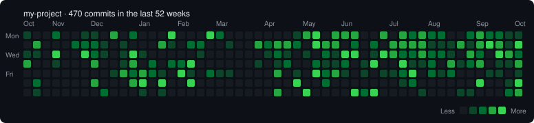

# gitpulse

**Your commit history as a heatmap, right in the terminal.** One command, zero dependencies.

[](https://github.com/YOUR_USERNAME/gitpulse/actions/workflows/ci.yml)




GitHub's contribution graph only exists on github.com, only for repos on your profile. **gitpulse** gives you the same
picture for *any* local repository (work repos, private repos, the one you never pushed) plus the stats you actually
want: current streak, longest streak, busiest day, favourite weekday.

## Install

```bash
pipx install git+https://github.com/YOUR_USERNAME/gitpulse
# or: pip install git+https://github.com/YOUR_USERNAME/gitpulse
```

Or skip installing entirely. It's pure standard library, so just clone and run:

```bash
git clone https://github.com/YOUR_USERNAME/gitpulse
cd gitpulse
python -m gitpulse /path/to/any/repo
```

You need Python 3.9+ and `git` on your PATH. That's it.

## Usage

```console
$ cd my-project
$ gitpulse
```

```text
my-project - last 52 weeks

    Oct   Nov     Dec       Jan     Feb     Mar       Apr     May     Jun       Jul     Aug       Sep     Oct
Mon ░ · · ▒ · · ░ ░ · ▓ · ▒ · · · █ · · · █ ▒ · · · · · · · ░ ▓ █ · ▓ ▓ ▓ · · ▓ · ▓ ▒ ▓ ▒ ▒ · · ▒ ▓ ▒ ▒ ░ ░
    · ▓ · · · ▒ ▒ ▒ ░ · ░ · · · ▓ ░ · ▒ ▒ · · ░ · · ▓ ▒ ▓ ▓ ▒ · █ ▓ ▓ · ▒ · ▒ · ▓ ▓ ▓ ▓ ░ ░ ░ ▓ ░ ▓ █ ▓ ░ █
Wed ░ ░ · █ · · █ ▒ ░ · ░ █ ░ · · · · · ░ · · · · · · ░ ▒ ░ · ░ · ▒ ░ █ █ · ░ █ ▓ ▒ ▒ ▓ ▒ ▒ ░ · ▓ ▒ · █ ▓ ▒
    ▓ · · ░ · · · ▓ · · ░ ▓ · ▒ · ▒ ▒ █ · · · · · · ░ · ░ ▒ · · ▒ ░ ░ ▒ · ░ █ · · █ ░ ░ ▒ · ▓ ░ ▒ ▓ · ░ ░ ▓
Fri · · · · · · · · · ░ ▓ ▒ ▓ ▒ ░ · █ ░ · ▒ ░ ░ · · · · ▓ · ░ · █ ▒ ▓ ░ · ░ · ░ ░ ▒ █ · ▒ ░ ▒ · · · ░ ░ · ░
    · ▒ · · · · · ▓ · · · ▓ █ · █ · · █ · · · · · · · · · · █ · · ▒ · · · · · · · ░ ▒ · · · · · · █ · · ░ █
Sun · ░ · · · · · · ▒ · · · ░ · ░ · · · · · · · · · · · ▓ · · █ · · · · █ ▒ █ · · · · ░ · · · ░ ░ · · · ▒ ▓

    Less · ░ ▒ ▓ █ More

Commits         470 on 178 active days
Current streak  9 days
Longest streak  9 days
Busiest day     2026-10-10 (6 commits)
Favourite day   Tuesday
```

(Real output. The demo repo is generated by [`scripts/make_demo_repo.py`](scripts/make_demo_repo.py), so you can
reproduce it. In a real terminal the squares are coloured GitHub-green.)

### Examples

```bash
gitpulse                           # current repo, last 52 weeks
gitpulse ~/code/myapp --weeks 26   # a different repo, last six months
gitpulse --author ada --all        # only Ada's commits, across every branch
gitpulse --no-merges               # ignore merge commits
gitpulse --svg assets/heatmap.svg  # also save the heatmap as an image
gitpulse --json | jq .stats        # machine-readable output
```

### Options

| Option | What it does |
| --- | --- |
| `PATH` | Repository to read (default: current directory) |
| `-w`, `--weeks N` | Weeks of history to show, 1 to 520 (default: 52) |
| `-a`, `--author PATTERN` | Only count commits whose author matches (same matching as `git log --author`) |
| `--all` | Count every branch, not just the checked-out one |
| `--no-merges` | Ignore merge commits |
| `--color auto\|always\|never` | Colour output. `auto` colours only on a terminal and respects `NO_COLOR` |
| `--svg FILE` | Also write the heatmap as a self-contained SVG, with a hover tooltip on every day |
| `--json` | Print per-day counts and stats as JSON instead of the heatmap |
| `-V`, `--version` | Show the version |

### Put a heatmap in your own README

```bash
gitpulse --svg assets/heatmap.svg
git add assets/heatmap.svg && git commit -m "Update commit heatmap"
```

Then reference it with ``. Re-run whenever you like.

## How it counts

- One count per commit, on the commit's **author date** (the date recorded in the commit itself).
- A streak is a run of consecutive calendar days with at least one commit. Your current streak stays alive until the
  end of today, so you don't "lose" it just because you haven't committed yet this morning.
- Weeks run Monday to Sunday.
- Colour levels are quartiles of your *active* days, so one 80-commit day doesn't wash the rest of the map out.
- It reads history with a plain `git log`, so very large repositories take a few seconds rather than milliseconds.

## Development

There are no dependencies, for tests either:

```bash
python -m unittest -v
```

The tests build real git repositories in temporary folders, so they exercise the same `git log` the tool uses.

Layout:

```
gitpulse/core.py     reading git, stats, the week grid, heat levels
gitpulse/render.py   terminal and SVG output
gitpulse/cli.py      argument parsing and wiring
tests/               unittest suite
scripts/             demo-repo generator used for the README
```

CI runs the suite on Linux and macOS across Python 3.9 to 3.13. Windows should work but isn't tested yet; a PR that
adds it to the matrix would be welcome.

## Ideas for contributions

- `--week-start sunday` for GitHub-style rows
- `--since` / `--until` for a fixed date range instead of "last N weeks"
- Compare two authors side by side
- A pure-ASCII mode for terminals without Unicode
- Windows in the CI matrix

Issues and PRs are welcome. Keep it dependency-free.

## License

[MIT](LICENSE)
